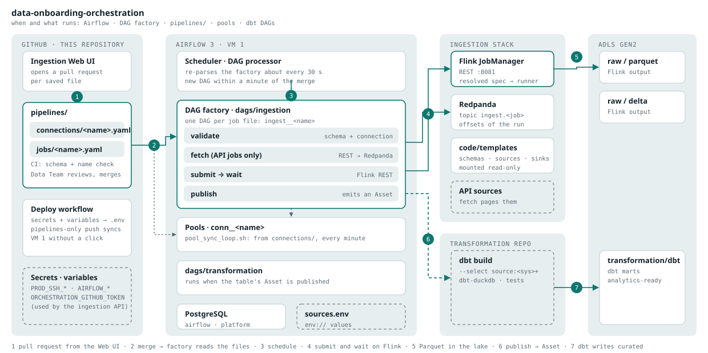

# data-onboarding-orchestration

Airflow for the data onboarding platform: one DAG per ingestion job, and one DAG per dbt transformation file, which runs after the ingestion tables it reads are loaded. This repository decides when and in what order things run. Flink lives in [data-onboarding-ingestion](https://github.com/thanhphat2609/data-onboarding-ingestion), dbt in [data-onboarding-transformation](https://github.com/thanhphat2609/data-onboarding-transformation).



## Repository layout

```
dags/
  ingestion/         DAG factory: every pipelines/jobs/<name>.yaml of this repo -> DAG ingest__<name>
  transformation/    one DAG per pipelines/transformations/*.yaml; scheduled on the table Assets ingestion publishes
  common/            settings shared by the factories
scripts/             pools conn__<name> from the connection files
tests/               offline tests; fixtures/ingestion/ stands in for the ingestion repo
infrastructure/      Airflow image, non-prod and prod Compose files, deploy (infrastructure/README.md)
docs/                ADRs, PostgreSQL guide
```

## Quick start

Airflow needs the ingestion stack: clone both repositories side by side.

```bash
bash ../data-onboarding-ingestion/infrastructure/non-prod/bootstrap.sh
bash infrastructure/non-prod/bootstrap.sh
docker compose -f ../data-onboarding-ingestion/infrastructure/non-prod/docker-compose.yml up -d --build
docker compose -f infrastructure/non-prod/docker-compose.yml up -d --build
```

A Codespace of this repository does all of this by itself: it clones data-onboarding-ingestion and starts both stacks. Airflow is on port 8080, the Web UI on 3000, Flink on 8081. Details: [infrastructure/README.md](infrastructure/README.md).

## Checks

```bash
pip install -r requirements-dev.txt
ruff check dags scripts tests && ruff format --check dags scripts tests
vulture          # unused code
pytest -q
```

CI also builds the image and parses the fixture jobs with real Airflow.

### Comments and dead code

- Comments say **why** (a constraint, a decision, an ADR), not what the next line does. A module starts with a docstring.
- A public function gets a one- or two-line docstring when its name and types don't tell the whole story: what it returns, when it raises, what it changes. Functions of about 15 lines or more always get one.
- No commented-out code; Git keeps history.
- When a change makes a function, file or setting unused, delete it in the same pull request, with its tests and docs. `vulture` fails CI on unused code; if the use is outside what it reads (a hook, another repository), add the name to `ignore_names` in `pyproject.toml` with a comment saying who uses it.

## Documentation

| Document | Contents |
|---|---|
| [ADR-0001](docs/adr/0001-orchestration-repo.md) | Why Airflow has its own repository |
| [ADR-0002](docs/adr/0002-repo-contracts.md) | What Airflow reads from the other repositories |
| [ADR-0004](docs/adr/0004-transformation-dags.md) | Transformation DAGs from YAML, dbt-duckdb in the image, Assets between DAGs ([plan](docs/plans/0001-transformation-dags.md)) |
| [dags/ingestion/README.md](dags/ingestion/README.md) | The ingestion DAG factory |
| [infrastructure/README.md](infrastructure/README.md) | Running it, non-prod and prod |
| [docs/postgresql.md](docs/postgresql.md) | The `airflow` and `platform` databases |
